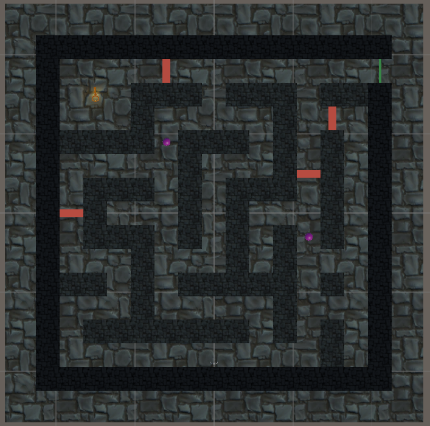

# SWE 585 Homework 3 – A Simple 3D Maze Escape Game

**Name, Surname:** Yalım Özçağlayan  
**Unity Version:** 6000.3.26f1 (URP)  
**Scene:** `Assets/Scenes/MazeScene.unity`  
**Video:** https://youtu.be/aDyq1b5auOw

---

## Game Description

### Maze-like platform
*In the game the player should navigate through a maze-like platform with multiple paths to choose from. At least 2 paths should be available with one path containing a key object that the player must find and the other path that reaches the Door to end the game. You are expected to create a platform that has at least 2 different paths to navigate. Optionally, the platform can be enclosed with walls.*

The maze is a 45 m × 45 m stone dungeon, fully enclosed by walls, standing on a 53 m × 53 m floor. The centre of the maze is at (0, 0, 0).

The maze is drawn as a 15 × 15 text map inside `MazeBuilder.cs` (`#` = wall, space = path, `D` = door). Each letter is a 3 m × 3 m × 3 m block, so the corridors are 3 m wide and the walls are 3 m high. Right-clicking the script and choosing **Build Maze** places a cube for every `#`. Outer walls get a dark material and inner walls a light one, so the borders are easy to see.

From the start point at the bottom of the maze the player can go left or right. There are many branches, dead ends and loops, so there is more than one way to reach the key and the door.

*Top view of the maze. Red = fire traps, green = door (top-right), gold = key (top-left), purple = guards. The player starts in the middle of the bottom corridor.*

### Player
The player is the Third Person Controller from Unity's **Starter Assets** package, with a camera that follows from behind.

<table>
  <tr><td>Move</td><td>W A S D</td></tr>
  <tr><td>Sprint</td><td>Hold Shift</td></tr>
  <tr><td>Jump</td><td>Space</td></tr>
  <tr><td>Look around</td><td>Mouse</td></tr>
  <tr><td>Music on / off</td><td>M</td></tr>
  <tr><td>Pause (Resume / Quit)</td><td>Esc</td></tr>
</table>

These controls are also shown on the screen in the bottom-left corner during the game.

### Key
*The key object, preferably a basic cube, should be affected by physics including forces, collisions and gravity. The player should be able to push the key around.*

The key is a big rusty golden key (the **Rust Key** model from the Asset Store) with a soft point light, so it can be seen from far away. It sits in the key room in the top-left corner of the maze.

For physics the key works like a box: it has a **Box Collider** a little smaller than the model and a **Rigidbody** (mass 2 kg, continuous collision detection), so it falls with gravity, collides with the walls and slides when pushed. Its rotation is frozen, so it never rolls over or turns sideways in a corridor and always slides straight. The model is scaled up to about 1 m × 0.8 m × 1.9 m, so the character pushes it instead of stepping over it.

The key has a frictionless physics material, so it slides along the walls instead of getting stuck on them. Linear damping slows it down quickly, so it stops soon after the player stops pushing.

The player pushes it with the `BasicRigidBodyPush` script on the character, which adds a force to the key every time the character walks into it.

### Door and winning
*Collision of the key with the door shall end the game. You are expected to utilize the OnCollisionEnter function for that. Door Object can be a basic plane that will be opened when collision occurs with the key.*

The door is a wooden double castle door in a stone frame (the **Medieval Castle – Modular** pack from the Asset Store). It closes the only opening in the outer wall, at the top-right of the maze, and it lines up with the top corridor, so the key can be pushed out of the key room and along the corridor to the door.

The door has an invisible box collider that fills the opening. `Door.cs` uses `OnCollisionEnter`: when the object that hits the door is the **Key**, a coroutine swings the two door wings open around their hinges in 1.5 seconds, and then the game shows the win screen. If the player touches the door, nothing happens.

### Fire traps
*The player must overcome a challenge to get the key. The challenge should be a trap that periodically enables and disables. So that if the player gets caught, it should die before being able to complete the game. You are expected to use Coroutines so that the movement of the trap occurs periodically.*

There are **4 fire traps**. Each one is a wall of flames (particle system) across a corridor, with a dark burnt mark on the floor that is always visible, so the player knows where the fire will come out.

- **Trap 1** is at the exit of the key room. It is the only way in and out, so the player has to pass it to get the key and again to push the key out.
- **Trap 2** and **Trap 3** block two corridors on the right side of the maze.
- **Trap 4** blocks the long corridor on the left side of the maze.

`Trap.cs` runs a coroutine (`FireLoop`) that repeats forever: flames on, `WaitForSeconds(onTime)`, flames off, `WaitForSeconds(offTime)`. Each trap has its own on/off times set in the Inspector, so they do not burn at the same moment.

The trap has a trigger collider. In `OnTriggerStay`, if the fire is on and the object inside is the player, the player dies. The key can pass through the fire safely.

### Guards
*Also add guards who constantly move from a specific point to another specific point along the path. If the player passes in front of the guards and is too close to the guards, the user will fail.*

There are **2 guards**. Each guard is a robot (**Space Robot Kyle** from Unity's Starter Assets) that walks between two points with a walking animation, stops for 1 second at each end, slowly turns around and walks back.

- **Guard 1** patrols the long corridor on the left side of the maze, from (−6, 9) to (−6, −9).
- **Guard 2** patrols the long corridor on the right side, from (12, −3) to (12, −15).

`Guard.cs` uses three coroutines: `Patrol` loops between the two points, `TurnTo` rotates the guard a little every frame until it faces the next point, and `WalkTo` moves the guard a little every frame (`yield return null`) until it reaches the target. The script also tells the robot's Animator when to play the walk and idle animations.

**Catching the player:** a guard sees up to 4 m in front of it, 60° to the left and right. Every frame it checks whether the player is inside this area and sends a raycast to make sure there is no wall in between. If the player is seen, the player fails. Passing behind a guard or behind a wall is safe.

**Vision cone:** a red see-through fan is drawn on the floor in front of each guard (`VisionCone.cs`). It has the same size as the area the guard really sees, and it is cut where a wall is in the way, so the player can see exactly where it is dangerous.

### Background music
*The game shall have a background music that can be toggled on and off.*

A looping background track plays from the start of the game. Pressing **M** mutes and unmutes it (`MusicToggle.cs`).

---

## Winning, losing and pausing

- **Win:** push the key into the door.
- **Lose:** walk into a burning fire trap, or get caught by a guard.

When the player wins or loses, the game freezes and a screen shows the result ("You escaped! You win!", "You got burned by the fire!" or "A guard caught you!") with **Play Again** and **Quit** buttons. Play Again restarts the level.

Pressing **Esc** during the game pauses it and shows **Resume** and **Quit** buttons.

All of this is handled by `GameManager.cs`, which uses `Time.timeScale` to freeze and resume the game.

---

## Scripts

<table>
  <tr><td><code>MazeBuilder.cs</code></td><td>Builds the maze walls from the text map</td></tr>
  <tr><td><code>Door.cs</code></td><td>Opens the door wings (coroutine) and wins the game when the key hits the door (<code>OnCollisionEnter</code>)</td></tr>
  <tr><td><code>Trap.cs</code></td><td>Turns the fire on and off (coroutine) and kills the player</td></tr>
  <tr><td><code>Guard.cs</code></td><td>Patrols between two points and turns around (coroutines), plays the robot animations and catches the player</td></tr>
  <tr><td><code>GuardAnimationEvents.cs</code></td><td>Receives the footstep signals from the robot's walk animation</td></tr>
  <tr><td><code>VisionCone.cs</code></td><td>Draws the guard's view area on the floor, cut by walls</td></tr>
  <tr><td><code>MusicToggle.cs</code></td><td>Turns the background music on and off with M</td></tr>
  <tr><td><code>GameManager.cs</code></td><td>Win / lose screen, pause menu, Play Again and Quit</td></tr>
</table>

## Assets from the Unity Asset Store

<table>
  <tr><td>Starter Assets – Third Person (Unity Technologies)</td><td>Player character, follow camera, and the Space Robot Kyle model and animations used for the guards</td></tr>
  <tr><td>Hand Painted Stone Texture (LowlyPoly)</td><td>Stone texture for the maze walls and the floor</td></tr>
  <tr><td>Rust Key (Aleksn09)</td><td>Key model</td></tr>
  <tr><td>Medieval Castle – Modular (AS Advance Studios)</td><td>Double door and stone frame model</td></tr>
</table>
